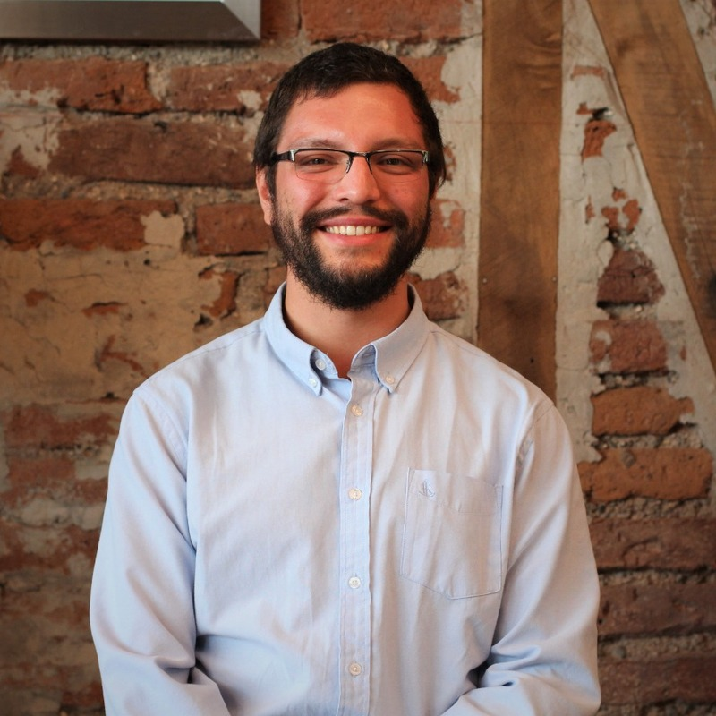

# Franco Ferrari-Accardi

**Electronic Engineer & Educator in Manchester, UK**

I design and build learning systems, educational robotics programmes and workflow automations for organisations working with children, young people and adults developing digital skills. I work in English and Spanish.

 

---

## What I Work On

- **EdTech & Computational Thinking:** Interactive learning apps, coding games and project based robotics curricula that teach sequencing, logic, debugging and sensor integration.
- **Full Stack Charity Operations:** Production intranets, offline first mobile apps and multilingual public forms supporting daily operations in the UK and Ghana (312 learner records, 2,564 attendance records and 176 sessions logged).
- **AI & Workflow Automation:** End to end n8n pipelines, AI assisted grant and content tools grounded in organisational context, and bilingual AI evaluation rubrics.

---

## Featured Projects

### 1. EdTech & Educational Robotics

| Project | Description | Live / Stack |
|---|---|---|
| **[Fido's Kente Quest](https://github.com/fferracc/fidos-kente-quest)** | Browser coding game teaching children sequencing, decomposition and step by step debugging. Built independently and donated to Sovereign House GH. | [Live App](https://fidos-quest-game.web.app) · HTML5 Canvas, JavaScript |
| **[Kids Learning App](https://github.com/fferracc/kids-learning-app)** | Spoken early years app for alphabet, numbers and simple addition designed for pre-readers. Built independently and donated to Sovereign House GH. | [Live App](https://kids-learning-app-12ebc.web.app) · React 19, TypeScript, Web Speech API |
| **[mBot Neo Curriculum](https://github.com/fferracc/mbot-robotics-curriculum)** | 12 hour project based robotics syllabus (6 sessions) for ages 11 to 16 covering sensors, conditionals, logic operators and autonomous line following. | mBot2 (CyberPi), mBlock 5 |

### 2. Full Stack Digital Platform (Sovereign House GH)

| Project | Description | Live / Stack |
|---|---|---|
| **[SHGH Intranet Portal](https://github.com/fferracc/shgh-intranet-portal)** | Staff operations system covering student and volunteer recruitment, attendance analytics, leave, policies, laptop inventory, funding tracker and AI assistants. | [Live Portal](https://shgh-portal.web.app) · Next.js 15, TypeScript, Firebase, Cloud Functions |
| **[SHGH Learning App (UK)](https://github.com/fferracc/shgh-learning-app-uk)** | Android and web app for UK courses, offline registers, volunteer hours and automatic rollback over the air updates. | [Live App](https://shgh-lms1.web.app) · Capacitor, JavaScript, Firebase |
| **[SHGH Attendance App (Ghana)](https://github.com/fferracc/shgh-attendance-app-ghana)** | Offline first Android and web app for school attendance (Creche to Primary), school library loans, leave and policy tracking in Ghana. | [Live App](https://shgh-attendance-redesign.web.app) · Capacitor, JavaScript, Firebase |
| **[Multilingual Application Forms](https://github.com/fferracc/shgh-application-forms)** | Public enrolment and partner referral forms in five languages (English, Arabic, Tigrinya, Amharic and Farsi) with RTL layout and PayPal webhooks. | React 19, Vite, i18next, Firebase |

### 3. AI & Workflow Automation

| Project | Description | Stack |
|---|---|---|
| **[n8n Automations](https://github.com/fferracc/n8n-automations)** | Automated student onboarding (Google Workspace provisioning, Google Classroom enrolment, Gmail and WhatsApp welcome messages) and PayPal payment reconciliation. | n8n, Google Workspace API, Firestore, PayPal, Twilio |
| **[Website & Safeguarding Automation](https://github.com/fferracc/shgh-website-automation)** | Local WordPress mirror, REST API publishers, Puppeteer live audits and an OpenCV pipeline that detects and anonymises children's faces in workshop photos. | Python, OpenCV, Node.js, Puppeteer, WordPress REST API |

---

## Technical Stack

`React` · `Next.js` · `TypeScript` · `JavaScript` · `Firebase (Auth, Firestore, Functions, Hosting, Storage)` · `Capacitor (Android)` · `Tailwind CSS` · `n8n` · `Node.js` · `Python` · `OpenCV` · `Puppeteer` · `LaTeX` · `Claude & Gemini APIs`

---

## Education & Background

- **MA Education (Social Justice)**, University of Birmingham, UK (Merit)
- **BSc Electronic Engineering**, Universidad de La Frontera, Chile (Distinction)
- **Current:** Digital Inclusion Officer, Sovereign House GH (Greater Manchester & Ghana)
- **Previous:** STEM Learning Manager, Eureka! Science + Discovery; National Programme Manager (Educational Robotics), Fundación Mustakis, Chile
- **Research Interests:** Computational thinking, Bayesian Knowledge Tracing, Rasch modelling
